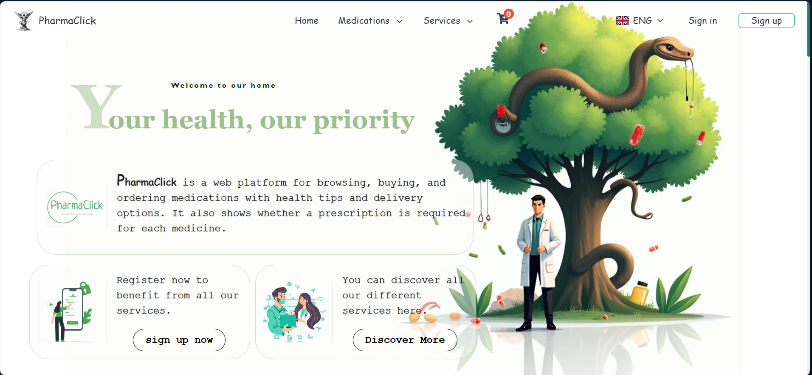
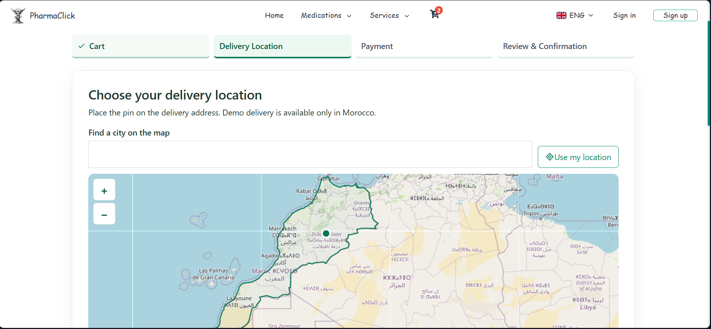

# PharmaClick

**A multilingual pharmacy storefront and checkout demo built with React.**

Browse a sample medication catalog, manage a cart, and walk through a simulated order with an interactive delivery map for Morocco. PharmaClick is a frontend project with browser-local demo accounts and order history.


[](LICENSE)

[GitHub repository](https://github.com/hisokaBK/PharmaClick) · [Hosted demo (older build)](https://pharma-click.netlify.app/) · [Run locally](#local-development)

The hosted demo predates the checkout and password reset shown in this README. Run the current source locally to try those features.

## Screenshots

### Home and navigation



The homepage provides entry points to the storefront, healthcare resources, and demo accounts.

### Morocco delivery checkout



The delivery step displays the selected pin, city search, and the checkout progress indicator. Map data © [OpenStreetMap contributors](https://www.openstreetmap.org/copyright).

## About

PharmaClick demonstrates how users can move from product discovery to an order review and printable invoice in a single-page application. React Router connects the storefront, healthcare content, account pages, and checkout. The catalog and most content ship with the application. Redux holds catalog and cart state, while browser storage retains demo account data and preferences.

## Features

| Area | What you can try |
| --- | --- |
| Catalog and cart | Search products by name, filter by category or browse by prescription requirement, open product details, and adjust cart quantities. |
| Demo accounts | Register, sign in and out, edit profile details, and manage a local avatar. Forgot Password updates the password of a matching local demo account while preserving its cart and orders. Registration, sign-in, and recovery use field-level validation and password visibility controls. |
| Languages and navigation | Switch between English, French, and Arabic. English is the default, and Arabic switches the interface to right-to-left layout. The site uses a responsive navbar and navigation drawer. |
| Delivery and checkout | Search for a city to center the interactive map, then select a pin. Geolocation and manual coordinates are also available. Confirm the address, choose simulated cash or card payment, and review the order. Upcoming steps stay unavailable until their requirements are met. |
| Orders and invoices | Reopen browser-local demo orders from a signed-in profile or separate guest history. Print invoices or save them as PDFs using a supported browser print dialog. |
| Feedback and resources | Inline form errors, toast notifications, and confirmation dialogs support key actions. Healthcare resource pages include educational articles and quizzes. |

## Checkout workflow

1. Browse the catalog, add products to the cart, and proceed to checkout.
2. Choose a delivery pin. The app checks the point against its bundled Morocco coverage boundary.
3. Enter and confirm the delivery address. Known city names are checked against the selected pin.
4. Choose demo cash on delivery or demo bank card. The card option asks for no card details.
5. Review the order, confirm it, and open the printable invoice. The order stays in this browser and can be reopened from order history.

See the [checkout implementation notes](src/checkout/README.md) for geographic coverage, validation, and data retention details.

## Technology stack

| Layer | Implementation |
| --- | --- |
| Frontend | React 19 and JavaScript |
| Styles and interaction | CSS, Bootstrap 5, Framer Motion, React Icons, and Lucide |
| Routing and state | React Router 7, Redux 5, and React Redux |
| Internationalization | A React context provider, JSON catalogs, and the browser's `Intl` APIs |
| Maps | Leaflet 1.9, OpenStreetMap raster tiles by default, and bundled Natural Earth boundary and city data |
| Browser APIs | LocalStorage for demo accounts, persisted account carts, orders, and language preference. IndexedDB for profile photos. Web Crypto for salted PBKDF2 password verifiers. |
| Tooling and hosting | Create React App (`react-scripts`), Jest, React Testing Library, ESLint, and Netlify configuration |

## Project structure

```text
PharmaClick/
├── docs/                 # README images and catalog research
├── public/               # Static images, medicine artwork, and SPA redirects
├── src/
│   ├── App.js            # Routes and application providers
│   ├── components/       # Shell, navigation, account UI, and shared feedback
│   ├── Com_Medications/  # Catalog, product details, and cart
│   ├── Com_servess/      # Healthcare resource pages
│   ├── checkout/         # Map, checkout, order history, and invoices
│   ├── css/              # Shared and page-level styles
│   ├── data/             # Catalog data and product descriptions
│   ├── i18n/             # Language provider, selector, and EN/FR/AR catalogs
│   └── store/            # Redux logic, demo accounts, and profile photos
├── netlify.toml          # Build and SPA routing configuration
└── package.json          # Dependencies and scripts
```

## Local development

Use Git, Node.js 20 or newer, and npm. The project was checked with Node.js 22.

```bash
git clone https://github.com/hisokaBK/PharmaClick.git
cd PharmaClick
npm ci
npm start
```

The development server defaults to [http://localhost:3000](http://localhost:3000) when the port is free. The clone checks out the default branch. Use the branch or local checkout containing the features you want to try.

Run the test suite once and create a production build with these commands.

```bash
npm test -- --watchAll=false --runInBand --testTimeout=20000
npm run build
```

The build writes static files to `build/`. To preview them, use a static host that falls back to `index.html` for client routes. The project has no dedicated preview script.

## Deployment

The [Netlify configuration](netlify.toml) runs `npm run build` and publishes `build/`. A `200` rewrite from `/*` to `/index.html` lets React Router handle direct page loads. The same fallback is provided in [`public/_redirects`](public/_redirects).

The default build requires no environment variables. For an alternate map tile provider, set the optional variables below before building.

| Variable | Purpose |
| --- | --- |
| `REACT_APP_CHECKOUT_TILE_URL` | Leaflet tile URL template, typically with `{z}`, `{x}`, and `{y}` placeholders. |
| `REACT_APP_CHECKOUT_TILE_ATTRIBUTION` | Visible attribution required by the tile provider. |

These values are public in the client bundle. Use HTTPS for hosted geolocation and Web Crypto. Map tiles require network access, but the coverage check uses bundled data.

## Demo limitations

- Accounts, photos, and saved orders stay in the browser profile and site origin where they were created. Clearing site data removes them.
- Password reset uses a local account lookup without email verification. It is designed for the demo and has no production authentication backend. Use demo credentials.
- Orders, payment choices, and delivery are simulated. No funds move and no pharmacy fulfills an order.
- The map validates the selected point against a generalized boundary. Users confirm their written street address against the pin.

## Author and license

Created by [Bilal Bakessou](https://github.com/hisokaBK). Released under the [MIT License](LICENSE).
